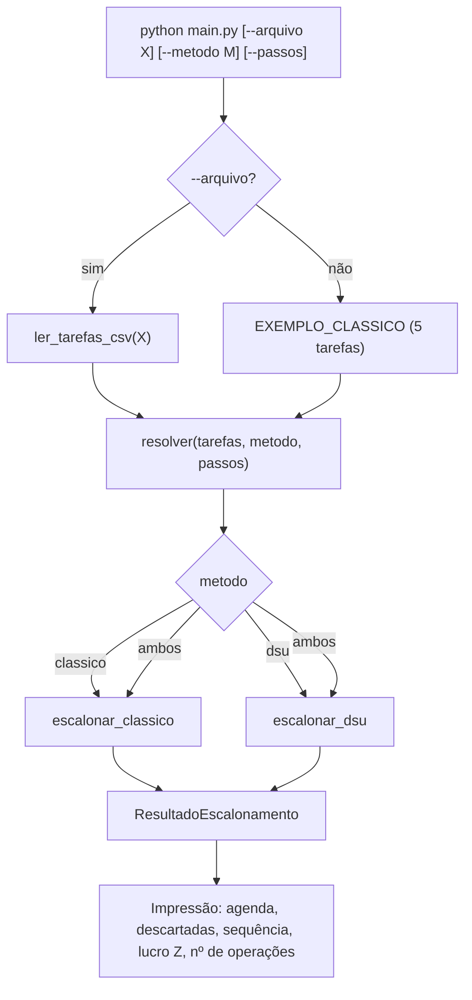
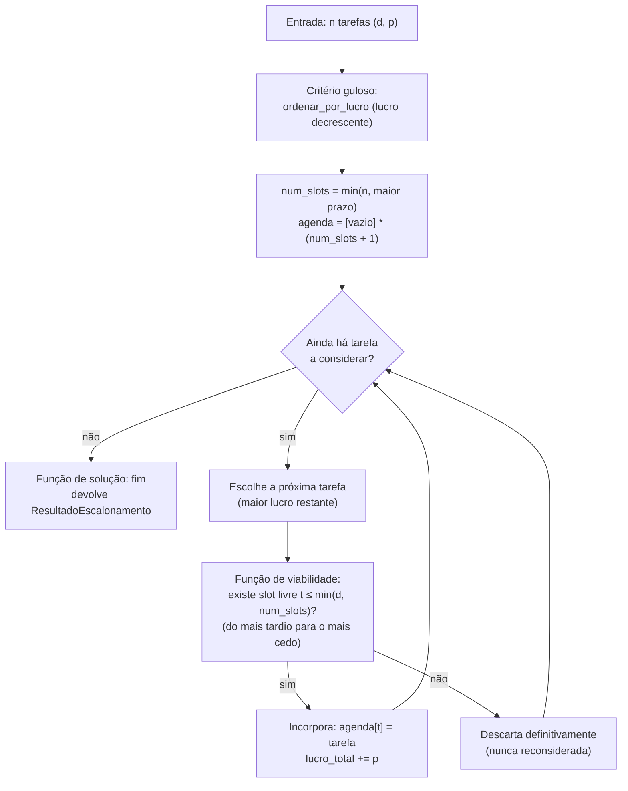

# Fluxo de Execução e Referência das Funções

Documento do **Integrante 1** (código-fonte). Explica o caminho de uma execução, do comando no terminal até a agenda final, e descreve cada função de `codigo/escalonamento.py` e `codigo/main.py`.

## 1. Visão geral

## 2. O algoritmo guloso, passo a passo

O algoritmo segue o procedimento genérico de algoritmo guloso da Aula 10.

| Conceito da Aula 10 | Implementação |
|---|---|
| Conjunto de opções | lista `ordenadas` |
| Critério guloso de escolha | `ordenar_por_lucro`: maior lucro primeiro |
| Função de viabilidade | laço `while` (clássico) ou `SlotsLivres.encontrar` (Union-Find) |
| Incorporar à solução | `agenda[slot] = tarefa` |
| Descartar | `rejeitadas.append(tarefa)` |
| Função de solução | fim do laço `for` |
| Função objetivo | `lucro_total` (Z) |

### Por que o slot mais tardio?

Ocupar o último slot possível deixa os primeiros slots livres para tarefas que ainda vão chegar com prazo curto. Se a tarefa `e` (prazo 3) fosse posta no slot 1, uma tarefa de prazo 1 perderia a única vaga que tem.

## 3. Execução comentada do exemplo

Entrada: `a(2,100)`, `b(1,19)`, `c(2,27)`, `d(1,25)`, `e(3,15)`, com 3 slots.

| Etapa | Escolha | Slots testados | Estado da agenda `[1, 2, 3]` | Decisão | Z |
|---|---|---|---|---|---|
| 1 | a (100) | 2 | `[–, a, –]` | incorporada no slot 2 | 100 |
| 2 | c (27) | 2 (ocupado), 1 | `[c, a, –]` | incorporada no slot 1 | 127 |
| 3 | d (25) | 1 (ocupado) | `[c, a, –]` | descartada | 127 |
| 4 | b (19) | 1 (ocupado) | `[c, a, –]` | descartada | 127 |
| 5 | e (15) | 3 | `[c, a, e]` | incorporada no slot 3 | **142** |

A sequência de execução é c → a → e. Foram 6 testes de slot, ou seja, a operação fundamental rodou 6 vezes.

## 4. Union-Find (`SlotsLivres`)

A estrutura responde a uma pergunta: **"qual é o maior slot livre ≤ t?"**

- `pai[t] == t` significa que o slot t está livre.
- `pai[0]` é uma sentinela que indica que não há vaga.
- `ocupar(s)` faz `pai[s] = s - 1`.
- `encontrar(t)` segue os ponteiros até a raiz e, no caminho, aplica a compressão de caminho.

Exemplo com 3 slots:

| Operação | `pai` (índices 0..3) | Resposta |
|---|---|---|
| início | `[0, 1, 2, 3]` | |
| `encontrar(2)` | `[0, 1, 2, 3]` | 2 |
| `ocupar(2)` | `[0, 1, 1, 3]` | |
| `encontrar(2)` | `[0, 1, 1, 3]` | 1 |
| `ocupar(1)` | `[0, 0, 1, 3]` | |
| `encontrar(2)` | `[0, 0, 0, 3]` (caminho comprimido) | 0, ou seja, sem vaga |

É a mesma estrutura usada no algoritmo de Kruskal (Aula 10). Cada busca custa O(α(n)) amortizado.

## 5. Referência das funções

### `codigo/escalonamento.py`

| Nome | Tipo | Descrição |
|---|---|---|
| `Tarefa(id, prazo, lucro)` | dataclass imutável | Uma tarefa. Lança `ValueError` se o prazo for menor que 1 ou o lucro for negativo. |
| `ResultadoEscalonamento` | dataclass | Solução: `agenda`, `rejeitadas`, `lucro_total`, `verificacoes`, `metodo`. Propriedades `escalonadas` e `num_slots`. |
| `ordenar_por_lucro(tarefas)` | função | Critério guloso. Timsort, O(n log n), estável. |
| `calcular_num_slots(tarefas)` | função | Retorna `min(n, maior prazo)`. |
| `escalonar_classico(tarefas, verbose=False)` | função | Guloso com busca linear do slot. O(n²). |
| `SlotsLivres(num_slots)` | classe | Union-Find com `encontrar(t)` e `ocupar(s)`. |
| `escalonar_dsu(tarefas, verbose=False)` | função | Guloso com Union-Find. O(n log n). |
| `ler_tarefas_csv(caminho)` | função | Lê um CSV `id,prazo,lucro` e ignora linhas iniciadas por `#`. |
| `formatar_numero(valor)` | função | Imprime `142` em vez de `142.0`. |
| `ALGORITMOS` | dict | `{"classico": escalonar_classico, "dsu": escalonar_dsu}` |

### `codigo/main.py`

| Opção | Efeito |
|---|---|
| (nenhuma) | Demonstração com o exemplo clássico e a tabela de etapas |
| `--arquivo CAMINHO` | Lê as tarefas de um CSV |
| `--metodo classico \| dsu \| ambos` | Escolhe a implementação (padrão: `ambos`) |
| `--passos` | Imprime a tabela de etapas |

## 6. Função de custo

**Operação fundamental:** testar se um slot está livre. O campo `verificacoes` conta quantas vezes ela foi executada.

| Caso (clássico) | Quando ocorre | T(n) |
|---|---|---|
| Melhor | cada tarefa acha vaga no 1º teste (prazos distintos) | n |
| Pior | todos os prazos iguais a n | Σ i, para i = 1..n, = n(n+1)/2 |

Pela regra da soma da notação O: ordenação O(n log n) + busca O(n²) = **O(n²)**. Na versão com Union-Find, o resultado é O(n log n) + O(n·α(n)) = **O(n log n)**. O espaço é O(n) nas duas.
