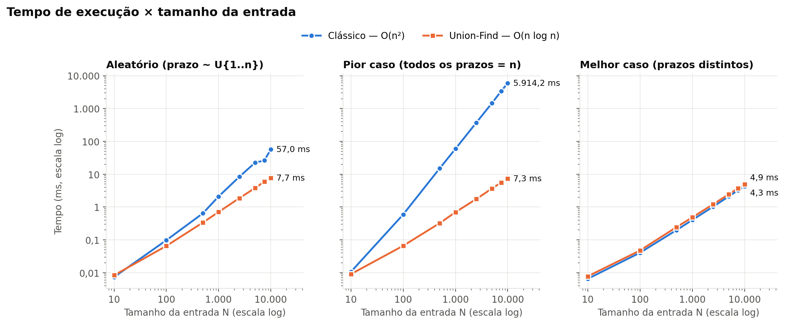
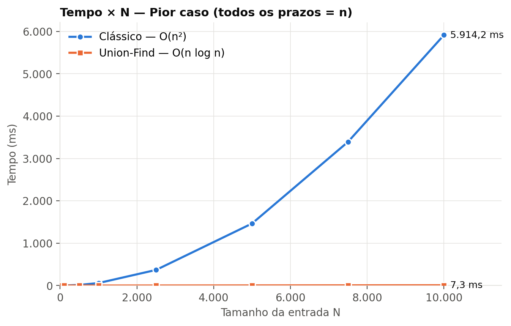
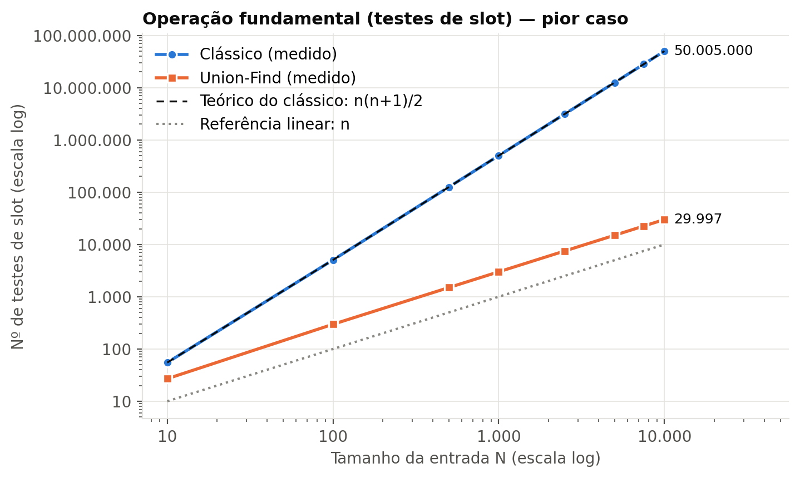

# Resultados obtidos e análise prática de desempenho

**Integrante 4 (Lucas Almeida).** Material para o PDF (Integrante 2) e para os slides (Integrante 3).
Todos os números vêm de [resultados/tabelas.md](resultados/tabelas.md) e podem ser regenerados com `testes/benchmark.py`.

## Resumo em três frases

1. **Correção:** as duas implementações acertaram todos os 21 testes. Em 400 entradas aleatórias pequenas, elas acharam o mesmo lucro máximo que a força bruta, que testa todos os 2ⁿ subconjuntos.
2. **Teoria confirmada:** no pior caso, o clássico executou **exatamente n(n+1)/2** testes de slot (50.005.000 para N = 10.000), e seu tempo cresceu **×99,8** quando N foi multiplicado por 10, o comportamento esperado de O(n²).
3. **Diferença prática:** com N = 10.000 no pior caso, o clássico levou **5,9 s** e o Union-Find **7,3 ms**, ou seja, **812 vezes mais rápido**, com a mesma resposta.

---

## 1. Metodologia

| Item | Escolha |
|---|---|
| Tamanhos | N = 10, 100, 1.000, 10.000 (pedidos) + 500, 2.500, 5.000, 7.500 (para desenhar as curvas) |
| Cenários | **Aleatório** (prazo ~ U{1..n}), **pior caso** (todos os prazos = n), **melhor caso** (prazos distintos 1..n) |
| Medição | `time.perf_counter()`, coletor de lixo desligado durante a medição, 1 execução de aquecimento + **5 repetições**, valor reportado = **mediana** |
| Justiça | as duas versões recebem a **mesma entrada** (semente fixa `2026 + N`) |
| Custo independente da máquina | nº de execuções da **operação fundamental** (teste "este slot está livre?") |
| Ambiente | Python 3.9.6 (CPython), macOS, Apple Silicon (arm64). Ver [resultados/ambiente.txt](resultados/ambiente.txt) |

**Testes de correção** ([test_escalonamento.py](test_escalonamento.py)):
- casos montados à mão, incluindo o exemplo da demonstração (Z = 142);
- casos de borda: lista vazia, uma tarefa, prazos enormes, lucros empatados, lucro zero ou fracionário;
- rejeição de entradas inválidas;
- **400 instâncias aleatórias comparadas com força bruta**;
- igualdade das duas versões para N = 1.000 e 5.000;
- conferência das fórmulas de custo.

## 2. Tabela principal: tempo de execução (ms)

| Cenário | N | Clássico O(n²) | Union-Find O(n log n) | Clássico ÷ Union-Find |
|---|---:|---:|---:|---:|
| Aleatório | 10 | 0,007 | 0,008 | 0,9× |
| Aleatório | 100 | 0,098 | 0,065 | 1,5× |
| Aleatório | 1.000 | 2,10 | 0,707 | 3,0× |
| Aleatório | 10.000 | 57,00 | 7,70 | 7,4× |
| **Pior caso** | 10 | 0,011 | 0,009 | 1,2× |
| **Pior caso** | 100 | 0,595 | 0,066 | 9,0× |
| **Pior caso** | 1.000 | 59,24 | 0,697 | 85,0× |
| **Pior caso** | **10.000** | **5.914,2** | **7,28** | **812,5×** |
| Melhor caso | 10 | 0,007 | 0,008 | 0,8× |
| Melhor caso | 100 | 0,041 | 0,048 | 0,9× |
| Melhor caso | 1.000 | 0,404 | 0,485 | 0,8× |
| Melhor caso | 10.000 | 4,27 | 4,94 | 0,9× |

## 3. Operação fundamental: medido × teórico

| Cenário | N | Clássico (medido) | Clássico (teórico) | Union-Find (medido) |
|---|---:|---:|---:|---:|
| Pior caso | 10 | 55 | 55 = n(n+1)/2 | 27 |
| Pior caso | 100 | 5.050 | 5.050 = n(n+1)/2 | 297 |
| Pior caso | 1.000 | 500.500 | 500.500 = n(n+1)/2 | 2.997 |
| Pior caso | 10.000 | **50.005.000** | **50.005.000 = n(n+1)/2** | **29.997** |
| Melhor caso | 10.000 | 10.000 | 10.000 = n | 10.000 |
| Aleatório | 10.000 | 438.586 | entre n e n(n+1)/2 | 29.539 |

A contagem medida **coincide exatamente** com a fórmula da função de custo do Integrante 1. No pior caso, o Union-Find faz 3n − 3 consultas, ou seja, cerca de 3 por tarefa: o efeito da compressão de caminho.

## 4. Crescimento quando N é multiplicado por 10

Esta é a forma mais direta de "ler" a complexidade nos dados. Se o custo é O(n²), multiplicar N por 10 multiplica o tempo por 100. Se é O(n log n), multiplica por cerca de 13 (de 1.000 para 10.000). Se é O(n), multiplica por 10.

| Cenário | Método | 100 → 1.000 | 1.000 → 10.000 | Esperado |
|---|---|---:|---:|---|
| Pior caso | Clássico | ×99,6 | **×99,8** | ×100 (O(n²)) ✔ |
| Pior caso | Union-Find | ×10,5 | ×10,4 | ≤ ×13 (O(n log n)) ✔ |
| Aleatório | Clássico | ×21,5 | ×27,1 | entre ×10 e ×100 |
| Aleatório | Union-Find | ×10,8 | ×10,9 | ≤ ×13 ✔ |
| Melhor caso | Clássico | ×9,9 | ×10,6 | ×10 (n testes) ✔ |
| Melhor caso | Union-Find | ×10,2 | ×10,2 | ≤ ×13 ✔ |

## 5. Gráficos

Arquivos PNG em 200 dpi em [resultados/graficos/](resultados/graficos/). As cores são as mesmas em todos: **azul = clássico** e **laranja = Union-Find**.

| Arquivo | Uso sugerido |
|---|---|
| `1_tempo_loglog_cenarios.png` | **Slide principal.** Três cenários lado a lado em escala log-log. A inclinação de cada reta mostra a ordem de crescimento: o clássico no pior caso sobe com o dobro da inclinação do Union-Find. |
| `2_tempo_linear_pior_caso.png` | **Slide de impacto.** Em escala normal, aparece a parábola do O(n²), enquanto o Union-Find fica colado no zero. |
| `3_tempo_linear_aleatorio.png` | Caso realista: a diferença existe (7,4× em N = 10.000), mas é menor que no pior caso. |
| `4_operacao_fundamental_pior_caso.png` | Liga a prática à teoria: a contagem medida fica exatamente em cima da curva n(n+1)/2. |

## 6. Análise

**a) A teoria se confirmou nos dados.** No pior caso, a i-ésima tarefa testa i slots e a soma dá n(n+1)/2. O contador mediu exatamente esse valor para todos os N, e o tempo cresceu ×100 a cada década. Isso é O(n²) observado na prática, não só no papel.

**b) A complexidade assintótica só "aparece" com N grande.** Com N = 10, as duas versões levam cerca de 0,01 ms e a diferença está no ruído. Com N = 100, o Union-Find é 9× mais rápido no pior caso. Com N = 10.000, a vantagem chega a 812×. É o comportamento previsto: as constantes dominam para N pequeno e a ordem de crescimento domina para N grande.

**c) No melhor caso, o clássico é ligeiramente mais rápido (cerca de 0,9×).** As duas versões executam exatamente n testes de slot. Mas cada teste do Union-Find passa por uma chamada de método (`encontrar`) e pelo laço de compressão, enquanto o clássico faz só uma comparação no vetor. Mesma ordem de crescimento, constante um pouco maior. Esse é um bom exemplo de que a notação O esconde constantes.

**d) No caso aleatório, o custo do clássico depende da instância.** Ele fica entre o melhor (n) e o pior caso (n²/2). Com N = 10.000, foram 438 mil testes, 44 por tarefa em média, contra 50 milhões no pior caso. Por isso a curva aleatória do clássico é irregular (5.000 → 7.500 subiu pouco). O tempo acompanha o nº de testes daquela entrada (168 mil → 186 mil), e a variação entre repetições ficou abaixo de 10%. Não é ruído de medição.

**e) O Union-Find se comportou praticamente como linear.** O fator foi ×10,4 a ×10,9 por década, e não ×13. A ordenação é O(n log n), mas na prática custa pouco perto do laço principal em Python, e cada busca no Union-Find faz um número constante de consultas (cerca de 3 por tarefa no pior caso, por causa da compressão de caminho). Assim, o termo n·α(n) domina e α(n) é constante na prática.

**f) As duas versões sempre deram o mesmo lucro Z.** O benchmark aborta se elas discordarem. A escolha entre elas é só uma questão de custo da função de viabilidade, não de qualidade da solução.

**Limitações:** tempos de uma única máquina (o valor absoluto muda em outro computador, mas as razões e os fatores de crescimento se mantêm); Python interpretado tem constantes maiores que C/Java; o caso aleatório usa uma instância por N, e por isso a contagem de operações foi reportada junto com o tempo.

## 7. Roteiro do bloco "Resultados obtidos e análise prática" (cerca de 2 min)

1. **Como testamos (20 s):** 21 testes de correção, incluindo comparação com força bruta em 400 entradas. Bateria com N de 10 a 10.000, em três cenários, mediana de 5 execuções.
2. **Tabela principal (30 s):** destacar a linha "Pior caso, N = 10.000": 5,9 s contra 7,3 ms, 812× mais rápido, com o mesmo lucro.
3. **Gráfico 2, linear no pior caso (30 s):** "esta é a parábola do n²; o Union-Find fica colado no eixo".
4. **Gráfico 4 ou Tabela 4 (30 s):** "a contagem medida é exatamente n(n+1)/2; multiplicar N por 10 multiplicou o tempo por 100".
5. **Conclusão prática (10 s):** para N pequeno tanto faz (e no melhor caso o clássico até ganha por constante). Para N grande, a escolha da estrutura de dados na função de viabilidade é decisiva.
